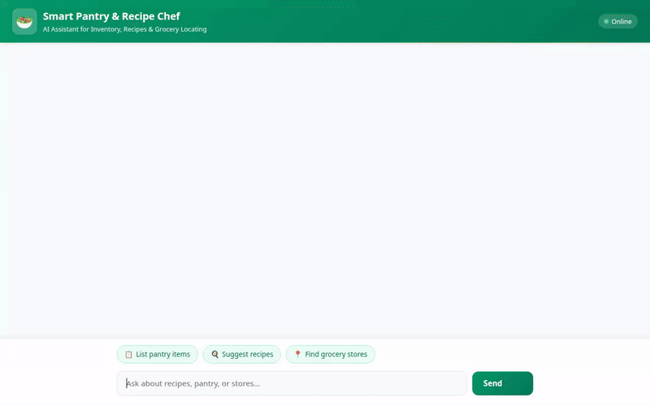

# 🥗 Smart Pantry & Recipe Chef

An AI-powered culinary assistant and inventory management agent built with Google's Agent Development Kit (ADK), Gemini 2.5, Vertex AI Memory Bank, and Google Cloud Services.



---

## 🌟 Overview

**Smart Pantry & Recipe Chef** helps users manage their home pantry inventory, discover recipes based on available ingredients, search online recipe databases, locate nearby grocery stores, visualize cooked dishes with AI image generation, and remember user dietary restrictions and allergies across conversations.

It features a custom FastAPI chat interface rendering native **A2UI v0.8** display cards.

---

## ✨ Key Features & Realized Capabilities

### 📦 Pantry Inventory Management
* **Firestore Integration**: Persists ingredients, quantities, units, categories, and expiration dates in a Google Cloud Firestore collection (`pantry_items`).
* **Inventory Tools**: Allows the agent to list, add/update, or remove pantry items in real time.

### 🍳 Recipe Matching & Search
* **Pantry Recipe Matcher**: Analyzes current inventory in Firestore against recipe requirements and calculates ingredient coverage percentages.
* **Online Recipe Search**: Connects to the **TheMealDB API** to fetch real recipes, step-by-step instructions, and ingredient measurements.

### 📍 Grocery Store Location (Google Maps)
* **Geocoding**: Converts street addresses or city names into latitude/longitude coordinates via the Google Maps Geocoding API.
* **Nearby Places Search**: Finds nearby supermarkets, bakeries, and grocery stores using the Google Maps Places API (New).

### 🖼️ AI Dish Image Generation & Public Storage
* **Vertex AI Image Generation**: Renders dish presentation images using the `gemini-3.1-flash-lite-image` model.
* **Cloud Storage Hosting**: Saves generated image bytes to a public Google Cloud Storage bucket (`smart-pantry-chef-media-57f30fd7`) and returns public HTTPS image URLs for inline rendering.

### 🧠 Cross-Session Memory & Safety
* **Vertex AI Memory Bank**: Integrates `VertexAiMemoryBankService` and `PreloadMemoryTool` to remember user dietary preferences, favorite cuisines, and food allergies across separate user sessions.
* **Allergy Safety Directive**: Checks remembered allergies prior to suggesting recipes and updates memory when new dietary restrictions are disclosed.

### 🧮 Code Execution Sandbox
* **Agent Engine Code Executor**: Runs Python code safely in the `AgentEngineSandboxCodeExecutor` for nutrition math and recipe scaling.

### 🎨 Native A2UI v0.8 Interface
* **Structured UI Cards**: Emits A2UI cards (Cards, Columns, Rows, Text, Images) for clean visual display in both ADK Web and custom frontends.

---

## 🏗️ Architecture & Google Cloud Stack

* **Core Agent Framework**: Agent Development Kit (ADK 1.1.0) on Python 3.11+
* **LLM Engine**: Gemini 2.5 (`gemini-2.5-flash`)
* **Database**: Google Cloud Firestore (`roles/datastore.user`)
* **Object Storage**: Google Cloud Storage (`roles/storage.objectAdmin`)
* **Long-Term Memory**: Vertex AI Memory Bank (`VertexAiMemoryBankService`)
* **Deployment Target**: Vertex AI Agent Runtime / Reasoning Engine (`roles/aiplatform.user`)
* **Location Services**: Google Maps Platform (Geocoding API & Places API New)
* **Frontend Proxy**: FastAPI + HTML5/CSS3 (Emerald Design) + A2UI Renderer

---

## 🛠️ Local Setup & Running Instructions

### Prerequisites
* Python 3.11+ and `uv`
* Google Cloud SDK (`gcloud` CLI)
* Node.js 18+ (optional, for recording tools)

### 1. Environment Setup

Configure your Google Cloud credentials and API keys:

```bash
# Authenticate Google Cloud CLI & Application Default Credentials
gcloud auth login
gcloud auth application-default login

# Set your active GCP project ID
gcloud config set project YOUR_GCP_PROJECT_ID

# (Optional) Export Google Maps API Key for location features
export GOOGLE_MAPS_API_KEY="YOUR_API_KEY"
```

### 2. Running the Agent Backend Locally

Start the local ADK dev environment:

```bash
# Install backend dependencies
uv sync

# Run ADK Web Playground
adk web app
```

The ADK dev UI will start on port `8000`.

### 3. Running the Custom FastAPI Chat Frontend

In a separate terminal window:

```bash
cd frontend

# Set environment variables pointing to your local/deployed agent
export AGENT_DIRECTORY="app"
export GOOGLE_MAPS_API_KEY="YOUR_API_KEY"

# Install frontend dependencies and launch FastAPI server
uv run python main.py
```

Open your browser to `http://localhost:8080` to interact with the custom UI.

---

## 🚀 Deployment Commands

### Deploy Agent Backend to Vertex AI Agent Runtime

```bash
agents-cli deploy agent \
  --project YOUR_GCP_PROJECT_ID \
  --region us-east1 \
  --update-env-vars GOOGLE_MAPS_API_KEY="YOUR_API_KEY"
```

### Deploy Frontend to Cloud Run

```bash
gcloud run deploy smart-pantry-chef-frontend \
  --source ./frontend \
  --region us-east1 \
  --allow-unauthenticated \
  --set-env-vars AGENT_ENGINE_RESOURCE_NAME="projects/YOUR_PROJECT_ID/locations/us-east1/reasoningEngines/YOUR_REASONING_ENGINE_ID",AGENT_DIRECTORY="app"
```

---

## 📄 License

Licensed under the [Apache License, Version 2.0](LICENSE).
